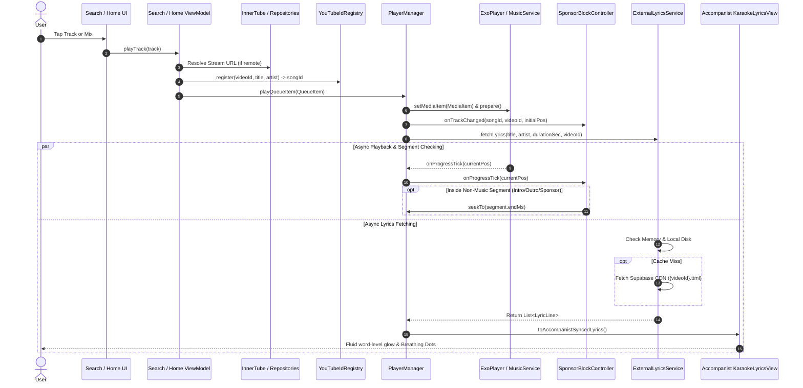

# Technical Architecture & System Design

This document details the ground truth architecture, data contracts, state management, and critical zones of the Melodia / Mimikyu Android music client.

---

## 1. Tech Stack & Core Dependencies

| Category | Technology / Library | Version & Specifications | Purpose in Codebase |
| :--- | :--- | :--- | :--- |
| **Language & Toolchain** | Kotlin | `2.0+` (JVM 11 target) | Core programming language across `:app` and `:innertube` |
| **Android SDK** | Android SDK | `compileSdk 36`, `targetSdk 36`, `minSdk 26` | Target runtime and modern Android 16 API compatibility |
| **UI Framework** | Jetpack Compose | BOM `2024.09.00` (Material 3) | Declarative UI, gesture mechanics, custom canvas shaders |
| **Blur & Glassmorphism**| Chris Banes Haze | `0.7.3` (`dev.chrisbanes.haze`) | Hardware-accelerated realtime background blur behind sheets |
| **Dependency Injection** | Koin | BOM `3.5.6` (`koin-android`, `koin-androidx-compose`) | Service locator and DI for ViewModels, singletons, repositories |
| **Audio Engine** | AndroidX Media3 | `1.4.1` (ExoPlayer + MediaSession + MediaService) | Gapless streaming, local caching, crossfade, and notification |
| **HTTP Clients** | OkHttp 4.12 & Ktor 2.3 | OkHttp Engine + ContentNegotiation | REST APIs, YouTube stream resolution, SponsorBlock, Supabase |
| **Serialization** | Kotlinx Serialization | `1.7.1` (JSON) | Type-safe JSON parsing for InnerTube, Supabase, and SponsorBlock |
| **Image Loading** | Coil Compose | `2.7.0` | Async album artwork loading, disk caching, and memory cache |
| **Local Storage** | AndroidX DataStore | Preferences DataStore | Reactive persistence for settings, audio cache, and auth |
| **Cloud Services** | Supabase & Firebase | Supabase Storage CDN, Firebase Auth, Firestore | Remote TTML storage CDN, cloud backup, and social activity |
| **Lyrics Engine** | MochaRealm Accompanist | Ported Accompanist Lyrics UI & Core | Multi-platform word-by-word syllable karaoke glowing & TTML |
| **Audio Metadata** | TagLib & BouncyCastle | Native TagLib + SpongyCastle crypto | Local audio file metadata scanner & Kugou KRC decryption |

---

## 2. Directory & Module Map

```
melodia-app/
├── innertube/                                    # Standalone library module for YouTube Music InnerTube communication
│   ├── src/main/java/com/metrolist/innertube/    # Raw InnerTube API calls, models, crypto signatures, and visitor decoders
│   └── build.gradle.kts                          # Module dependencies (Ktor, Kotlinx Serialization, Timber)
└── app/src/main/java/
    ├── com/lin0721/linmusic/                     # Main application package
    │   ├── MainActivity.kt                       # Root ComponentActivity configuring edge-to-edge and system bars
    │   ├── MimikyuApp.kt                         # Root app scaffold hosting navigation, mini-player, and player sheets
    │   ├── MimikyuNavHost.kt                     # Animated router orchestrating page transitions between screens
    │   ├── MimikyuNavigationState.kt             # Multi-stack state machine preserving navigation history per tab
    │   ├── core/                                 # Shared foundation, business logic, and engines
    │   │   ├── api/                              # Base HTTP interfaces, API response wrappers, and status codes
    │   │   ├── audiometa/                        # Audio metadata lookup, fingerprinting, and duration validation
    │   │   ├── auth/                             # User authentication, Google Sign-In, and cookie persistence
    │   │   ├── common/                           # Global utility functions, extensions, and common error models
    │   │   ├── contentfilter/                    # Explicit lyrics and regional content filtering rules
    │   │   ├── download/                         # Background track downloading and offline management via WorkManager
    │   │   ├── firebase/                         # Firebase Auth and Cloud Firestore sync for user libraries
    │   │   ├── friend/                           # Social friend activity tracking, profile cards, and follow lists
    │   │   ├── history/                          # Playback history persistence and timestamp recording
    │   │   ├── importer/                         # External playlist import parsers (Spotify, Apple Music, URLs)
    │   │   ├── lastfm/                           # Last.fm scrobbler and artist portrait/bio scraper
    │   │   ├── localmusic/                       # Device storage scanner for local audio files and ID3 metadata
    │   │   ├── log/                              # Centralized structured logging engine (`AppLogger`)
    │   │   ├── lyrics/                           # Multi-tier lyrics cascade and Accompanist adapter pipeline
    │   │   ├── metadata/                         # Studio artwork resolution and metadata text cleaning
    │   │   ├── model/                            # Core domain models (`Track`, `Artist`, `Album`, `Playlist`)
    │   │   ├── network/                          # OkHttpClient factories, interceptors, and network monitor
    │   │   ├── player/                           # Media3 ExoPlayer wrapper, playback queue, and background service
    │   │   │   ├── innertube/                    # Bi-directional YouTubeIdRegistry mapping Long ID ↔ Video ID
    │   │   │   └── domain/                       # Pure lyrics parsers (`LyricParser`) for TTML, LRC, KRC, YRC
    │   │   ├── preferences/                      # Type-safe AndroidX DataStore preferences for player and app settings
    │   │   ├── qobuz/                            # Qobuz high-resolution audio resolver and metadata search
    │   │   ├── reccobeats/                       # Recommendation algorithms and track acoustic similarity scoring
    │   │   ├── songlike/                         # Reactive liked songs persistence and synchronization engine
    │   │   ├── sponsorblock/                     # Crowdsourced SponsorBlock skip client and playback skipper
    │   │   ├── ui/                               # Theme definitions, typography (SF Pro), colors, and micro-interactions
    │   │   └── update/                           # In-app update manager checking GitHub releases and APK installation
    │   ├── di/                                   # Koin Dependency Injection definitions
    │   │   ├── NetworkModule.kt                  # HTTP clients, Retrofit instances, and network monitoring
    │   │   ├── PlayerModule.kt                   # MediaControllerHolder, PlaybackQueue, and PlayerManager singletons
    │   │   ├── RepositoryModule.kt               # Repositories for Search, Playlist, Artist, Home, and Lyrics
    │   │   └── ViewModelModule.kt                # Jetpack Compose ViewModel bindings
    │   ├── feature/                              # Feature-specific presentation and domain modules
    │   │   ├── account/                          # User account profile, edit profile, and friends activity
    │   │   ├── artist/                           # Artist profile screen, discography, and portraits
    │   │   ├── home/                             # Home screen with daily artist hero pager and curated shelves
    │   │   ├── library/                          # User library, playlists, saved albums, and local songs
    │   │   ├── listendata/                       # Listening stats, time listened, and yearly analytics
    │   │   ├── player/                           # Full-screen player, cover carousel, waveform, and lyrics view
    │   │   ├── playlist/                         # Playlist and album detail screens with reorderable tracks
    │   │   ├── search/                           # Multi-tab real-time search, suggestions, and audio identifier
    │   │   └── settings/                         # Extended settings (audio quality, lyrics, UI, cache, updates)
    │   ├── com/mocharealm/accompanist/lyrics/    # Ported Accompanist multi-platform syllable lyrics engine
    │   │   ├── core/                             # Parsers, models, and mappers for TTML, LRC, KRC, and Syllables
    │   │   └── ui/                               # GPU-accelerated `KaraokeLyricsView`, `LyricsLazyListState`, and scenes
    │   └── com/mocharealm/gaze/capsule/          # Dynamic status bar lyrics pill for Android 16 live updates
```

---

## 3. Data Flow & State Management

### 3.1 End-to-End Discovery & Playback Flow



### 3.2 Global States & Reactive Singletons

1. **`PlayerManager`**:
   - Exposed States: `currentTrack: StateFlow<MediaItem?>`, `isPlaying: StateFlow<Boolean>`, `currentPosition: StateFlow<Long>`, `duration: StateFlow<Long>`, `queue: StateFlow<List<QueueItem>>`, `playMode: StateFlow<PlayMode>`.
   - Consumers: `MimikyuApp` (mini-player), `FullPlayerScreen` (controls, seekbar, carousel), `FullScreenLyricsView` (playback synchronization), `MusicService` (system notification).
2. **`YouTubeIdRegistry`**:
   - Thread-safe bidirectional registry mapping `Long` `songId` $\leftrightarrow$ `String` `videoId`.
   - Backed by in-memory `ConcurrentHashMap` and persistent `SharedPreferences` (`mimikyu_youtube_registry`).
   - Consumers: `PlaybackRepositoryImpl`, `ExternalLyricsService`, `SponsorBlockController`, `PlayerManager`.
3. **`SettingsPreferences`**:
   - Reactive AndroidX DataStore preferences for `zohoLyricsBaseUrl` (Supabase CDN), `audioQuality`, `streamCacheSize`, `fullScreenLyricTextSize`, `fullScreenLyricAlignment`.
4. **`LikedSongsStateStore`**:
   - Real-time `StateFlow<Set<String>>` maintaining liked video IDs across Home, Library, and Player screens.

---

## 4. Critical Tools & Fragile Zones (DO NOT BREAK)

### 4.1 Fragile Code Hotspots

1. **`YouTubeIdRegistry.kt`**:
   - **Risk**: Central single point of failure for track identity across streaming, lyrics, and sponsor skipping.
   - **Contract**:
     - `register(videoId: String, title: String, artist: String, ...): Long`
     - `getVideoId(songId: Long): String?`
     - `findVideoIdByTitleArtist(title: String, artist: String): String?`
   - **Rule**: Never remove persistence write-through to `SharedPreferences`. Without this, app restart clears video IDs and breaks playback resuming and lyrics lookup.

2. **`ExternalLyricsService.kt`**:
   - **Risk**: Complex 5-tier fallback cascade. Modifying order or error suppression breaks zero-delay local caching or floods third-party APIs.
   - **Contract**:
     - `fetchLyrics(title: String, artist: String, durationSec: Int, videoId: String?): List<LyricLine>`
     - `getCached(title: String, artist: String, durationSec: Int, videoId: String?): List<LyricLine>?`
   - **Rule**: Always query Supabase Storage CDN (`{videoId}.ttml`) before third-party APIs (BetterLyrics / Kugou / NetEase / LRCLIB). Always maintain strict Han/CJK character filtering for Western songs.

3. **`AccompanistLyricsAdapter.kt`**:
   - **Risk**: Converts internal `LyricLine` domain models to Accompanist `SyncedLyrics`.
   - **Contract**:
     - `List<LyricLine>.toAccompanistSyncedLyrics(title: String, artist: String): SyncedLyrics`
   - **Rule**: Syllable start and end times **must be absolute millisecond song timestamps**. Instrumental interludes must only trigger for gaps $\ge 3500\text{ms}$ (`3.5s`), preserving trailing vocal sustains below that threshold.

4. **`SponsorBlockController.kt` & `SponsorBlockClient.kt`**:
   - **Risk**: Auto-skip loops, audio stuttering, or missed video intro segments.
   - **Contract**:
     - `getSkipSegments(videoId: String): List<SponsorSegment>`
     - `onTrackChanged(songId: Long, explicitVideoId: String?, initialPosMs: Long)`
     - `onProgressTick(currentPosMs: Long)`
   - **Rule**: Always merge contiguous and overlapping skip segments. Never query only `music_offtopic`; all non-music tags (`intro`, `outro`, `preview`, `filler`, `sponsor`) must be queried.

---

## 5. UI & Rendering Pipeline

### 5.1 Layering Architecture

The visual presentation is structured as a vertical Z-index stack managed in [`MimikyuApp.kt`](file:///c:/Users/nishk/.gemini/antigravity-ide/scratch/melodia-app/app/src/main/java/com/lin0721/linmusic/MimikyuApp.kt):

```
+-------------------------------------------------------------+
| Layer 5: Modal Sheets (ShareSheet, QueueSheet, Dialogs)     |
+-------------------------------------------------------------+
| Layer 4: FullPlayerLyricsOverlay (Accompanist GPU Canvas)   |
+-------------------------------------------------------------+
| Layer 3: FullPlayerScreen (Drag-to-dismiss Sheet)           |
+-------------------------------------------------------------+
| Layer 2: MiniPlayerCard + Bottom Navigation Bar             |
+-------------------------------------------------------------+
| Layer 1: MimikyuNavHost (AnimatedContent Screens)           |
+-------------------------------------------------------------+
| Layer 0: Root Scaffold & Edge-to-Edge Background Canvas     |
+-------------------------------------------------------------+
```

### 5.2 Performance & Rendering Safeguards

1. **Text Layout Memoization**:
   - Accompanist's `KaraokeLyricsView` measures and computes text boundaries once via `rememberLyricsScene`. It completely bypasses per-frame JNI `getBoundingBox` calls during the render loop.
2. **Progress Loop Throttling**:
   - `PlaybackProgressTracker` runs its 25ms tick loop **only** when `ExoPlayer.isPlaying == true`. When paused, buffering, or idle, the coroutine loop suspends to consume 0% CPU.
3. **LazyList Key Stability**:
   - All items across Home mixes, Search results, and Playlists use stable string keys (e.g. `stableKey = "track_${item.id}"`) to prevent recomposition churn during list updates.
4. **Hardware-Accelerated Blur**:
   - Backdrop blur is handled via `dev.chrisbanes.haze`, which hooks into Android's native `RenderEffect` on Android 12+ (API 31+) and graceful fallback on older APIs.
