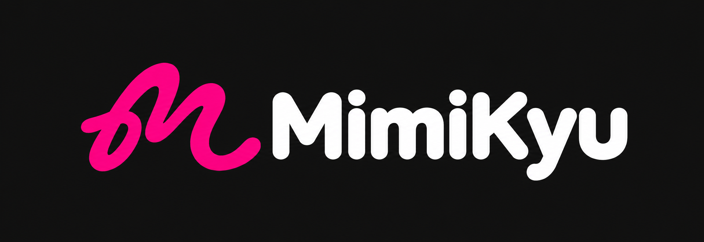

<div align="center">
  

  <h1>Mimikyu</h1>
  <p><strong>A modern, fluid Android music streaming app built with Jetpack Compose, real-time word-by-word synced TTML lyrics, sleek glassmorphism, and seamless cloud sync.</strong></p>

  <p>
    <a href="https://github.com/szzsuke/Mimikyu/releases/latest">
      
    </a>
  </p>

  <p>
    <a href="https://buymeachai.in/szzsuke" target="_blank">
      
    </a>
    &nbsp;
    <a href="https://buymeacoffee.com/szzsuke" target="_blank">
      
    </a>
  </p>

  <p>
    <a href="https://github.com/szzsuke/Mimikyu/releases"></a>
    <a href="https://developer.android.com"></a>
    <a href="https://kotlinlang.org"></a>
    <a href="LICENSE"></a>
    <a href="https://github.com/szzsuke/Mimikyu/stargazers"></a>
  </p>
</div>

---

## 🌟 Overview

**Mimikyu** is a high-performance, private, edge-to-edge music streaming client for Android. Powered by **YouTube Music InnerTube** and a curated database of **25,000+ synchronized TTML word-by-word karaoke lyrics**, Mimikyu delivers an immersive listening journey with hardware-accelerated fluid animations, real-time background blur, and cloud library synchronization.

---

## ✨ Key Features

- **🎤 Syllable-by-Syllable Glowing Karaoke Lyrics**:
  - Integrated with our cloud database of **25,000+ TTML lyrics** hosted on high-speed Supabase Storage CDN.
  - Accompanist-powered glowing syllable visualizer with smooth fluid auto-scrolling and tempo synchronization.
  - Multi-tier fallback cascade supporting TTML, LRC, YRC, and KRC.
- **⚡ AndroidX Media3 ExoPlayer Audio Engine**:
  - Gapless playback, intelligent pre-buffering, dynamic audio cache, and automatic retry on connection drops.
  - MediaSession background playback service with media notification controls and headset disconnect listener.
- **🎨 Modern Glassmorphism & Fluid UI**:
  - Built 100% in declarative **Jetpack Compose** with Material 3 dynamic color tokens extracted from album artwork.
  - Hardware-accelerated real-time background blur powered by **Chris Banes Haze**.
  - Dynamic Artist Hero carousel with high-resolution backdrops and curated home shelves.
- **☁️ Cloud Sync & Social Presence**:
  - Seamless Google Sign-In and account linkage powered by Firebase Authentication.
  - Real-time Cloud Firestore synchronization for your Liked Songs, custom playlists, and profile across devices.
- **📦 Universal Playlist Importer**:
  - Import playlists from Spotify, Apple Music, and YouTube Music via `.csv` or `.zip` archives.
  - 5MB upload size guard, zip bomb protection, header verification, and automatic routing into Liked Songs.
- **📱 Offline Music & Local Library**:
  - Room database persistence for offline caching.
  - Built-in local audio scanner supporting FLAC, MP3, and AAC with native TagLib ID3 tag extraction.
  - Switchable Library layout: Toggle between **Grid view** (default) and **List view**.
- **🎨 Social Share Engine**:
  - Generate Spotify-style lyric quote sharing cards and track cards with album art and QR links.
- **🛡️ Enterprise-Grade DevSecOps & Security**:
  - **Supabase Row Level Security (RLS)**: Enforces strict bucket policies preventing mass data dumps or scraping while allowing rapid single-song queries.
  - **Firebase App Check**: Hardened with Play Integrity provider to shield Firestore user collections from unauthorized bots and modified clients.
  - Zero hardcoded secrets in source code; fully decoupled via `local.properties` and `BuildConfig`.

---


---

## ☕ Support & Sponsor the Project

Mimikyu is an independent open-source project maintained with passion. If you enjoy using Mimikyu and appreciate the ad-free streaming experience, high-resolution lyrics database, and fluid UI, please consider supporting development:

<div align="center">

[](https://buymeachai.in/szzsuke)
&nbsp;&nbsp;&nbsp;&nbsp;
[](https://buymeacoffee.com/szzsuke)

<p>Your support directly covers backend database maintenance, TTML lyrics pipeline compute, and continuous feature development. Thank you!</p>

</div>

---

## 📥 Download & Installation

<div align="center">

| GitHub |
| :---: |
| <a href="https://github.com/szzsuke/Mimikyu/releases/latest"></a> |

</div>

- **Direct Download**: Grab the latest `.apk` from **[GitHub Releases](https://github.com/szzsuke/Mimikyu/releases/latest)**.
- **Bug Reports & Requests**: Submit feedback and ideas via **[GitHub Issues](https://github.com/szzsuke/Mimikyu/issues)**.

---

## 🏗️ Technical Architecture

Mimikyu adheres strictly to modern Android architecture principles with **Feature-Driven separation of concerns**:

```text
app/src/main/java/com/lin0721/linmusic/
├── MimikyuApplication.kt        # Entry point: Koin DI, Coil pre-warming, and Firebase App Check init
├── MainActivity.kt              # Single Activity: Edge-to-edge system bar insets & overlay handling
├── MimikyuApp.kt                # Root composition: Scaffold, navigation router, and miniplayer
├── MimikyuNavHost.kt            # Compose animated transition routing engine
├── MimikyuOverlays.kt           # Fullscreen player sheet, bottom drawers, and modal sheets
├── MimikyuNavigationState.kt    # Multi-stack backstack state coordinator
├── MimikyuPlayerSheetState.kt   # Smooth gesture-driven bottom sheet state machine
│
├── core/                        # Cross-cutting foundational modules
│   ├── api/                     # HTTP interfaces and base network models
│   ├── audiometa/               # Audio duration extraction and acoustic analysis
│   ├── auth/                    # Firebase Authentication and Google Credential Manager
│   ├── download/                # WorkManager offline download scheduling
│   ├── importer/                # Universal playlist importer (CSV, ZIP) with size guards
│   ├── log/                     # AppLogger structured logging and diagnostic handler
│   ├── lyrics/                  # Syllable-by-syllable TTML lyrics cascade & Accompanist adapter
│   ├── model/                   # Domain entities (Track, Artist, Album, Playlist)
│   ├── network/                 # OkHttp factories, logging, and HTTP/2 connection pooling
│   ├── player/                  # Media3 ExoPlayer audio service, playback queue, and notification
│   ├── preferences/             # Type-safe AndroidX DataStore preferences
│   ├── songlike/                # Cloud Firestore reactive liked songs repository
│   └── ui/                      # Material 3 tokens, SF Pro fonts, and micro-interactions
│
├── di/                          # Koin dependency injection modules
│
└── feature/                     # Business domain feature packages
    ├── account/                 # User profile, account management, and social friends
    ├── artist/                  # Artist discography, albums, and portrait banners
    ├── home/                    # Daily Artist Hero carousel and curated shelves
    ├── library/                 # User library (Grid and List layout support)
    ├── listendata/              # Listening statistics, playtime tracking, and milestones
    ├── player/                  # Full-screen player with Haze blur, visualizer, and lyrics
    ├── playlist/                # Playlist and album tracklist with reordering
    └── search/                  # Real-time search suggestions and audio recognition
```

---


## 🤝 Contributing

We welcome community contributions! Please review our **[CONTRIBUTING.md](CONTRIBUTING.md)** and use the provided **[Pull Request Template](.github/PULL_REQUEST_TEMPLATE.md)** before submitting pull requests.

---

## 📜 Disclaimer

1. Mimikyu is an open-source educational project exploring modern Android native architecture with Jetpack Compose.
2. Mimikyu does not host, store, or sell any copyright-protected audio files. All audio streams and metadata are resolved dynamically via public internet protocols.
3. All product names, logos, and brands are property of their respective owners.


---

<div align="center">
  <sub>Crafted with ❤️ by <a href="https://github.com/szzsuke">szzsuke</a> and open-source contributors.</sub>
</div>
